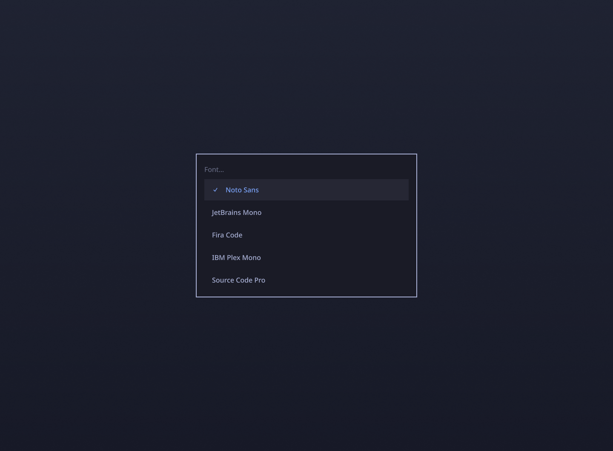
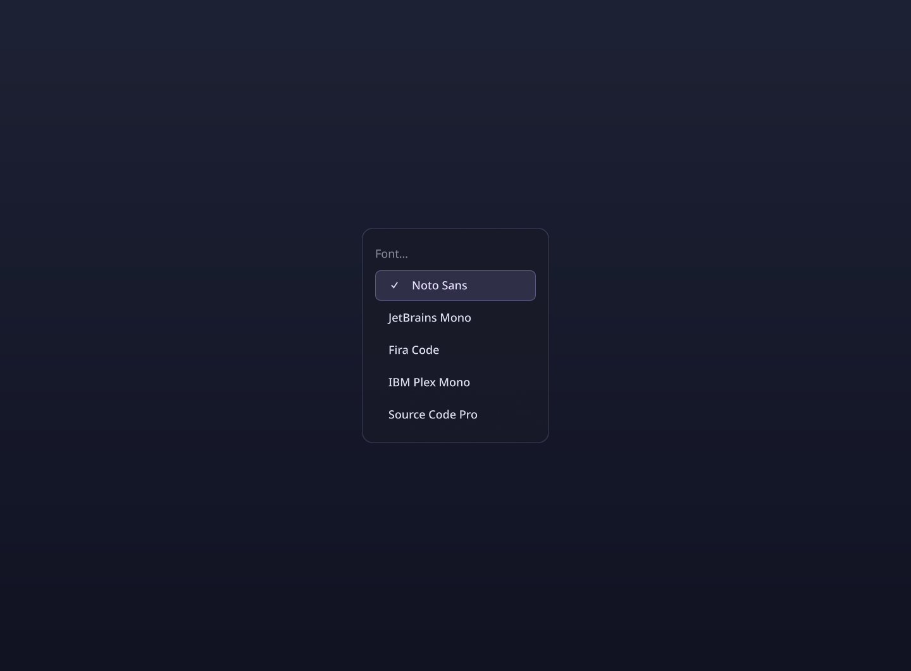
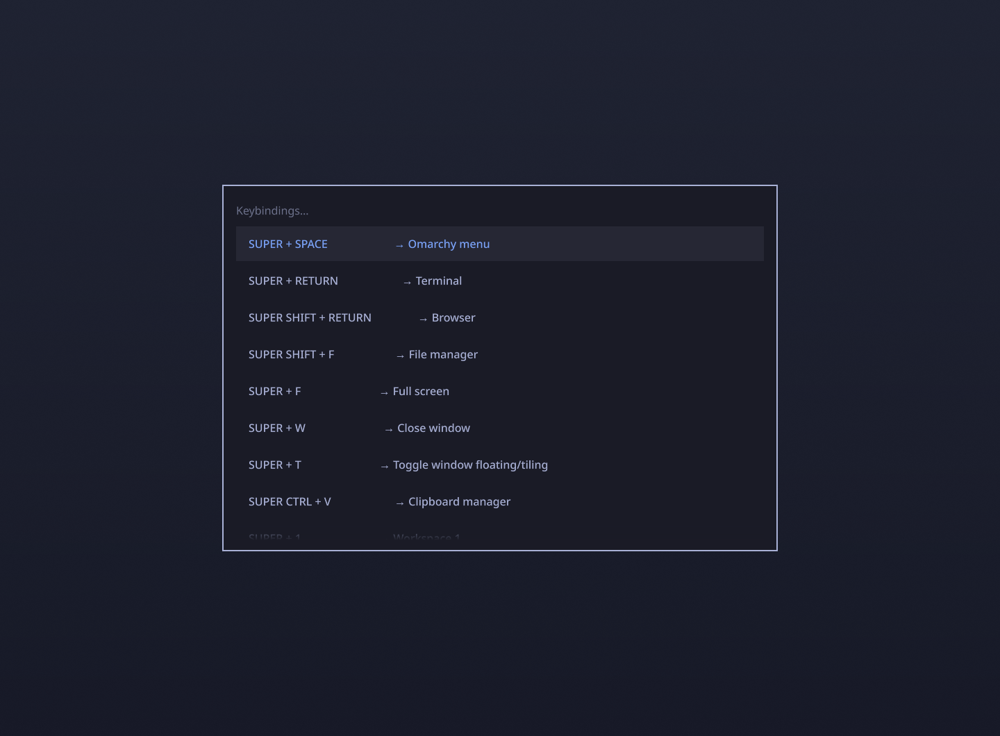
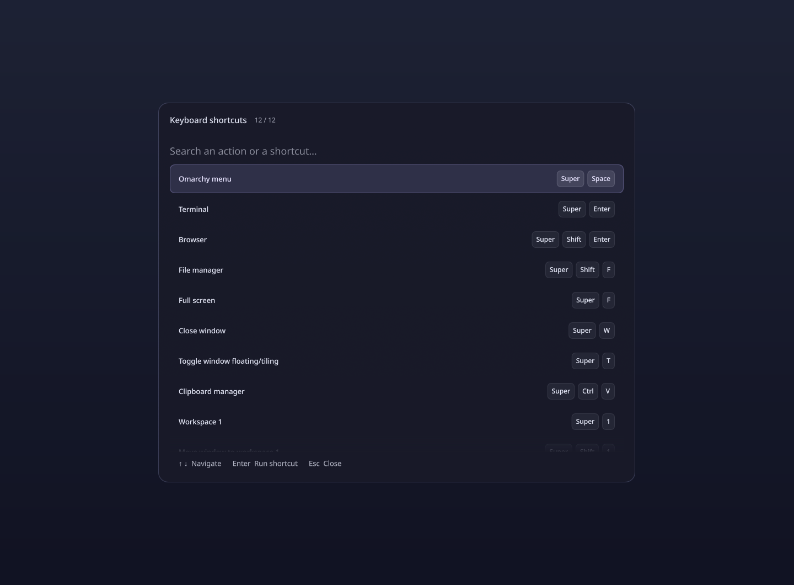
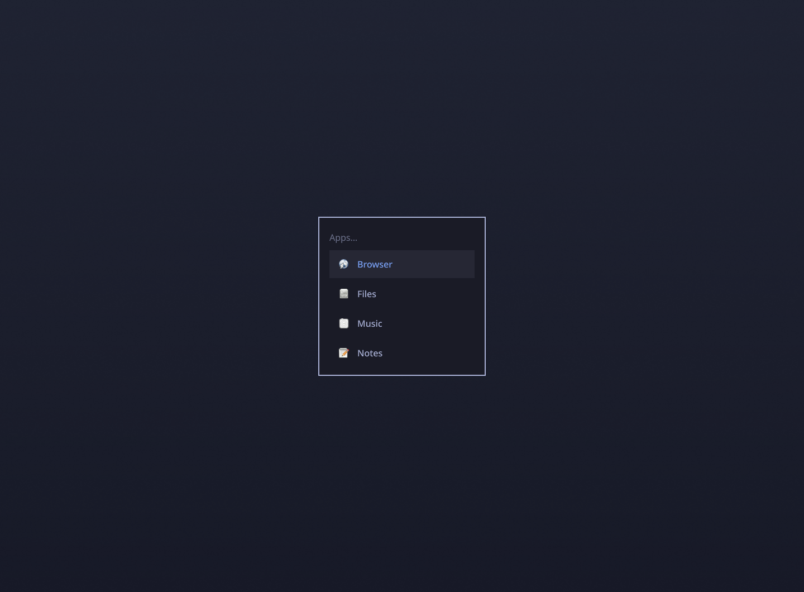
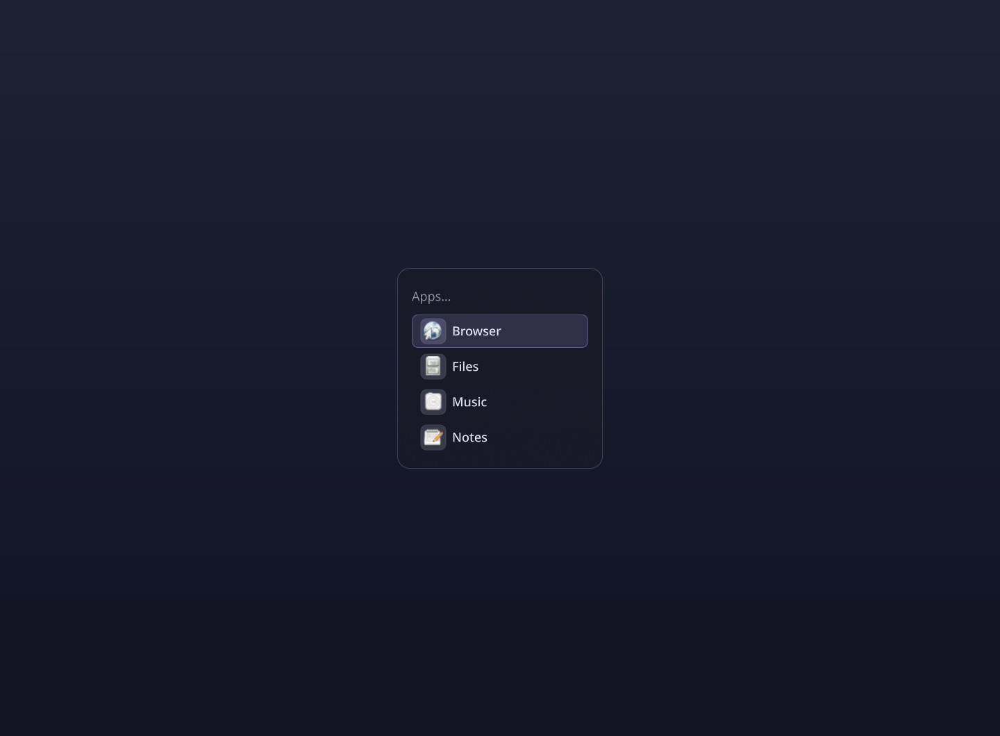

# Omarchy Nocturne

**v1.1.0:** restores the launcher after the Omarchy 4.5 API change, adds an
optional animated **Super+Alt+Space** grid, fixes workspace indicators, and
installs a post-update compatibility diagnostic. Includes earlier startup,
shortcut and rendering fixes. [Release notes](docs/RELEASE-v1.1.0.md).

Existing installations need a checked reinstall; pulling alone does not replace
installed files. Read [complete update instructions](docs/RECOVERY.md) and
[Omarchy 4.5 compatibility limits](docs/UPDATE-COMPATIBILITY.md) first.

A dark glass interface for Omarchy, with adaptive menus, organic motion, and a continuous transition from an app selection to its window.

**Community customization for Quickshell / Lua Hyprland.** This is a user-local collection of plugin clones and theme files. It is not an official Omarchy release.


## What changes

- **Adaptive Super+Space:** the card fits its content, including small Font menus and empty search results. Width and height change smoothly.
- **Optional Super+Alt+Space grid (Omarchy 4.5):** organic opening/closing, adaptive height and an icon-to-window morph on click or Enter. Install with `--app-grid` after reviewing the compatibility limits below.
- **Launch morph:** the selected app row expands into the window's actual tiled position. Content is revealed without scaling its typography; the spring has a restrained elastic finish.
- **Consistent panels:** calendar, audio, network, Bluetooth, weather and agents share the same entry, exit and interruption behaviour. Blur stays inside the cards.
- **Readable shortcuts:** actions form a clean column, combinations appear as individual keycaps, and search accepts multiple terms. Original shortcut actions are preserved.
- **Shared controls:** animated buttons, switches and sliders, visible keyboard focus, and correct recovery when a drag is cancelled.
- **Nocturne Glass:** a lavender accent, quiet borders, darker translucent surfaces, rounded windows and a stable workspace indicator.

[Watch the launcher morph](docs/media/launch-morph.mp4) · [Watch the adaptive menu](docs/media/adaptive-menu.mp4)


[Watch the optional app grid](docs/media/app-grid.mp4). This isolated demonstration
uses four synthetic entries and the real Qt Music demo, with the shipped grid and
morph components. The optional grid requires the 4.5 compatibility steps below.

## Stock → Nocturne

These are captures of real QML components from the same installed Omarchy version. Both use the same demonstration data, Noto Sans and neutral background. Stock uses the Tokyo Night palette and default square corners; Nocturne uses its shipped theme. This is a controlled component comparison, not a claim about every possible stock theme or font. The Music window is a small demonstration application.

| Omarchy stock | Omarchy Nocturne |
| --- | --- |
|  |  |
|  |  |
|  |  |

## Measured resources

[Resource measurements, raw counters and methodology](docs/PERFORMANCE.md) compare native stock components with Nocturne and document the launch-renderer optimization. Results are specific to the tested hardware and workloads.

## Compatibility

Tested with **Omarchy 4.0.6-1**, **Hyprland 0.56.2-4**, and **Quickshell 0.3.2.r7.g2b4501a-1**, on landscape and portrait outputs. Omarchy's older Waybar / `.conf` Hyprland setup is not supported.

Requires Python 3, the native Omarchy shell and Lua Hyprland API. No Claude subscription, council tools, OmaControl, extra daemon or compositor binary plugin is required. The shader is included precompiled; its GLSL source and rebuild command are provided.

On **Omarchy 4.5.0-3**, the launcher, optional grid, numeric panels and workspaces
were exercised on both outputs. **This is not a complete 4.5 shell port.** The
Nocturne bar still uses `left`, `center`, `right`; installations with nonempty
`centerBegin`, `centerEnd` or `tray` sections are refused before any writes to
avoid hiding widgets. The conservative version gate remains; opting into the
4.5 paths requires `--allow-untested`. See [compatibility](docs/UPDATE-COMPATIBILITY.md).

Plugin clones do not automatically receive future upstream changes. Review compatibility before updating Omarchy. The installer rejects untested Omarchy versions by default; `--allow-untested` is an explicit override, not a compatibility guarantee.

## Install

Run as your normal desktop user, without `sudo`:

```sh
git clone https://github.com/braga1k/omarchy-nocturne.git
cd omarchy-nocturne
python3 install.py install                 # inspect the dry run
python3 install.py install --apply
```

For an Omarchy 4.5 installation with a compatible three-section bar layout,
include the optional grid in the same installation transaction:

```sh
python3 install.py install --allow-untested --app-grid
python3 install.py install --allow-untested --app-grid --apply
```

The grid replaces the native dock service through the plugin clone mechanism;
existing dock pins/options and an explicitly disabled dock are preserved. It
requires the native 4.5 dock and application library. This does not change your
workspace model. [Optional global workspaces](docs/GLOBAL-WORKSPACES.md).

The installer merges stock widget references while preserving per-widget options and third-party entries. It saves the original managed files in `~/.local/state/omarchy-nocturne/install.json`, refuses conflicting custom files and rolls back writes if installation fails.

If you already use a custom clone of a replaced widget, switch it back to its native source first; the installer reports overlapping clones instead of silently bypassing them.

Then apply the palette, keeping your wallpaper:

```sh
# Note your current theme first, for example: cat ~/.local/state/omarchy/current/theme.name
OMARCHY_THEME_SKIP_BACKGROUND=1 omarchy theme set nocturne-glass
hyprctl reload
hyprctl configerrors
omarchy restart shell
```

Open Super+Space once, then save the first compatibility report:

```sh
python3 ~/.local/lib/omarchy-nocturne/check-compatibility.py
# Add --dock if you installed/enabled the optional grid, or --workspaces for the widget.
```

The post-update hook compares later upstream fingerprints with this baseline;
it reports a lazy, unopened menu as pending rather than successful.

The native theme command also applies colours to supported applications. Theme activation is a separate native operation, outside the installer's file transaction. Your fonts and wallpaper are not bundled or replaced. The public menu button retains the standard Omarchy symbol.

## Uninstall

First select your previous theme with `omarchy theme set <previous-theme>`. Then:

```sh
python3 install.py uninstall
python3 install.py uninstall --apply
hyprctl reload
hyprctl configerrors
omarchy restart shell
```

Uninstall checks for changes before restoring anything. If a managed file was edited after installation, it stops and lists the conflict; back up and reconcile that file before retrying. Additional files inside plugin directories are preserved. Keep the installation record until you have uninstalled.

To upgrade Nocturne, uninstall the current version, pull the new version, then install again. Do not copy a new payload over an existing installation record.

## Validation and limits

See [validation](docs/VALIDATION.md) for the evidence and its limits, and [architecture](docs/ARCHITECTURE.md) for the implementation.

The capture-based motion assessment is at **60 FPS**. It does not certify physical 360 Hz smoothness or input latency. Multi-window applications, ambiguous window classes, splash screens, hotplug, arbitrary per-window decorations, and all third-party tray menus are not universally covered. Unsupported or interrupted launches fall back to the native window, and a compositor-side watchdog prevents an abandoned capture from leaving it hidden.

## Development

Tests require Python 3.11+ and Lua 5.4 or newer. Startup regression tests are
mandatory in CI; a missing Lua interpreter is a failure, not a skipped test.

```sh
python3 -m unittest discover -s tests -v
# Qt 6 Shader Tools is needed only when rebuilding the shader:
/usr/lib/qt6/bin/qsb --glsl '100 es,120,150' --hlsl 50 --msl 12 \
  -o payload/.config/omarchy/ui/nocturne/morph-surface.frag.qsb \
  payload/.config/omarchy/ui/nocturne/morph-surface.frag
```

Keep changes in the user-local clones. Do not edit `/usr/share/omarchy`.

## Credits

Built on [Omarchy](https://github.com/omacom/omarchy), [Quickshell](https://quickshell.org/) and [Hyprland](https://hypr.land/). Omarchy-derived code retains its MIT licence and attribution to David Heinemeier Hansson. Nocturne additions are by Vitor Ferreira. See [LICENSE](LICENSE) and [third-party notices](docs/THIRD-PARTY.md).
