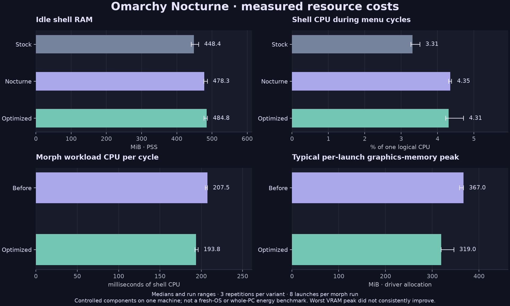

# Resource investigation — 5 November 2026

Nocturne's normal idle overhead is small on the tested desktop. The first priority was a correctness bug: the shortcut scanner could spin indefinitely in a Lua proxy loop. That bug is separate from the cost of glass and animation.

The renderer optimization removes repeated resizing of the morph's intermediate texture. In the controlled launch workload, it reduced shell CPU time by **6.6%**, sampled maximum proportional RAM by **4.4%**, and the **typical per-launch graphics-memory peak by 13.1%**. Those are medians of three runs, not universal improvements. **The median of whole-run worst graphics-memory peaks did not improve.**

## What a performance engineer adds

1. Separate runaway bugs, idle cost, transient peaks and actual interaction cost before comparing themes. Freeze visual requirements: no changed spring, duration, content scaling or window geometry.
2. Start from kernel counters, driver process allocations, scene-graph logs and consecutive native-resolution frames—not task-manager screenshots or subjective scores.
3. Use repeated, counterbalanced trials; retain raw observations; verify that the intended animation actually ran; use targeted ablations and lifecycle tests rather than lowering visual quality blindly.
4. Require evidence independent of the author: reproducible arithmetic from raw data, regression tests, native compositor checks, image comparisons, and an independent Sol review. A reviewer score is not a performance measurement.

## Stock components versus Nocturne

Ryzen 7 9800X3D, 16 logical CPUs, approximately 31 GiB RAM, RTX 5080 / NVIDIA 615.78.08; DP-1 2560×1440@359.98Hz and portrait HDMI-A-1 1080×1920@60Hz, both scale 1. Omarchy 4.0.6-1, Hyprland 0.56.2-4, Quickshell 0.3.2.r7.g2b4501a-1, Qt 6.12.

One native full shell at a time, fresh processes, scratch HOME copies, same background, user applications and third-party widgets. Stock uses native plugins, Tokyo Night, opaque bar, no blur/shadow and square decoration. Nocturne uses the local clones, theme and glass. User layout/bindings and common compositor animation overrides remain. **This is a controlled stock-component comparison, not a clean-install OS benchmark.**

Each run warms menu/audio, waits 8 s, measures 25 s idle, eight root→Font→close cycles, eight audio open→close cycles, then 5 s idle. Initial order: stock, Nocturne, Nocturne, stock, stock, Nocturne. Three further optimized runs check the final integration. No video recording or detailed rendering logs during these resource trials.

Shell CPU percentages below use **100%=one logical CPU**, not the entire 16-thread machine. They exclude waited child processes, which are reported in the downloadable data. RAM is PSS, which proportionally accounts for shared pages.

| Scenario | Stock shell CPU | Nocturne before optimization | Nocturne optimized | Stock PSS | Nocturne before | Nocturne optimized |
|---|---:|---:|---:|---:|---:|---:|
| Idle |0.04%|0.04%|0.16%|448.4 MiB|478.3 MiB|484.8 MiB|
| Menu cycles |3.31%|4.35%|4.31%|451.2 MiB|487.3 MiB|493.7 MiB|
| Audio cycles |3.52%|3.73%|3.81%|461.4 MiB|493.2 MiB|500.6 MiB|

Values are medians across runs. Idle PSS ranges: stock 441.4–462.5, Nocturne 477.5–487.1, optimized 477.6–487.2 MiB. This supports an extra **roughly 30–40 MiB of shell RAM** in this setup; it does not support an idle-RAM reduction from the morph optimization. Optimized idle CPU ranged 0.04–1.06%, including a visibly noisier third run. All runs remain in the data; no claim of a whole-desktop idle CPU improvement is made.

Before optimization, compositor CPU medians were 0.70→1.32% during menu cycles and 1.28→2.03% during audio cycles. Menu child processes consumed about 23% of one CPU in both variants while evaluating native settings/providers; that is not animation shading. Common user applications remain active, so global GPU utilization/power is contextual and cannot be attributed entirely to Nocturne. NVIDIA process utilization was unavailable (`-`), not zero.

## Morph optimization

The isolated workload uses the actual Menu/LaunchMorph components and a disposable Qt application, with an assertion that the selected Music entry enters the `moving` phase. It is a full-size destination on the landscape monitor; the real installed path is separately validated at full/half/quarter size on both outputs. Three runs per renderer, eight launch cycles per run, order before/after, after/before, before/after. Kernel/NVML samples every 50 ms; no recorder or verbose trace during these runs.

| Metric | Before, median [run range] | Optimized, median [run range] |
|---|---:|---:|
| Shell CPU per whole launch cycle |207.5 ms [205.0–207.5]|193.8 ms [192.5–196.3]|
| Maximum sampled PSS per run |246.7 MiB [243.5–249.2]|235.9 MiB [234.7–240.9]|
| Typical graphics-memory peak¹ |367.0 MiB [358.2–367.0]|319.0 MiB [319.0–346.2]|
| Maximum graphics memory across a run |381.5 MiB [377.0–413.5]|381.5 MiB [349.5–381.5]|
| Graphics memory after settling idle |90.1 MiB|90.1 MiB|

¹For each run, take the maximum observed allocation within 1.5 s of each launch, then the median of its eight launches; the table summarizes the three run medians. Sampling is not an allocator trace and may miss shorter peaks. The isolated harness has less infrastructure than the full desktop, so its absolute RAM/VRAM must not be compared directly with the previous table.

Implementation:

- Allocate a stable intermediate texture covering the destination plus the existing 4% overshoot allowance. Sample it at native pixel scale; crop in the shader instead of changing the framebuffer size each animation step.
- Skip border-gradient color-space conversion for fully covered interior fragments; antialiased edge fragments retain the original path.
- Release the texture source when inactive. The before/after idle graphics allocation was already equal; no measured idle-VRAM saving is claimed.
- Disable the compositor watchdog when idle and re-enable it on the next supported launch. A native compositor probe counted 20 callbacks over 2.01 idle seconds before, zero after; rearming still invoked callbacks. CPU savings from this tiny timer were below the benchmark's reliable resolution.

The stable-buffer and fragment changes were measured together; the data does not isolate their individual contribution. The spring, timings, capture resolution and source-icon decoding were preserved.

## Bugs fixed before treating performance as a theme cost

The native keybinding scanner evaluates configuration with callable table stubs. Iterating the stub returned by `hl.get_windows()` never terminated. The helper now declines that non-compositor context. An isolated bounded reproduction of v1.0.1 consumed 1.999 CPU-seconds in 2.002 wall-seconds before termination; the corrected helper completed in less than 1 ms. This proves that failure mode, not a general launch speedup. The actual native scanner now returns 203 bindings.

T3 Code advertises `t3code` in its desktop entry and `com.t3tools.T3Code` on Wayland. A namespace fallback requires agreement between the declared class, selected executable and actual process name. No title or substring guessing. Unknown/slow launches return to native feedback after 650 ms. The existing T3 client completed waiting→capturing→moving→handoff→idle; no second client or held tags remained.

## Validation and limits

- 25 public tests cover cold startup, offline parsing, keybinding-scanner regression, identity matching, watchdog/rearming, installation repair and recovery.
- Actual QML callbacks cover delayed arming, stale tickets, reactivation, two-output readiness and native fallback.
- Native installed full/half/quarter launches passed on both monitors; T3's existing window passed across outputs. Installed configuration reports `config ok` and no live config errors.
- Six GPU-rendered shader comparisons include final and intermediate geometry. Three integer window cases are byte-identical; the small row differs by at most 1 channel level. Fractional geometry changes antialiasing (1.18% of pixels differ by more than 2 levels in that fixture); it is **not** claimed bit-identical. Native-scale frame sequences are also inspected for layout/handoff regressions.
- Detailed Qt scene-graph logs were collected separately. This machine uses OpenGL ES, where Qt GPU timestamp collection is unsupported; CPU render-loop logs are not physical GPU frame times. No 360 Hz/input-latency, reboot, energy/battery or universal app-identity claim.
- Two initial diagnostic fixtures selected the wrong app and exercised fallback. They were explicitly discarded; all published morph trials assert `moving`.

## Recalculate the results

Run `python3 tools/analyze-performance.py`. It reads only [compressed raw counters](performance/samples.json.gz), whose [SHA-256](performance/samples.sha256) is supplied. No desktop interaction or dependencies beyond Python's standard library. All nine full-shell and six valid morph trials are retained. Identifiers, screenshots of personal applications and scratch-home configurations are not distributed. Re-running the live desktop experiment requires recreating the controlled fixtures described above; the read-only script reproduces the arithmetic, not the environment.

Definitions: [Linux process/PSS counters](https://www.kernel.org/doc/html/latest/filesystems/proc.html), [Qt scene-graph profiling](https://doc.qt.io/qtcreator/creator-qml-performance-monitor.html), [Qt texture-source behaviour](https://doc.qt.io/QT-6/qml-qtquick-shadereffectsource.html), [Qt GPU timestamp limitations](https://doc.qt.io/qt-6/qquickgraphicsconfiguration.html).

## Independent council review

One round, GPT-6.1 Sol: **APPROVE, 9.0/10 for this technical change, no findings**. The reviewer repeated all 25 inert tests, separately checked v1.0.1 repair/backup/uninstall, recalculated the raw counters, verified 96 payload hashes and the four installed files, and reproduced the shader binary and six image comparisons. Native frame sequences were inspected without interacting with the desktop.

Confidence was **high for data integrity and arithmetic**, and **medium-high for absence of regressions in the examined paths**. This does not establish high confidence for every application, machine, physical refresh rate or login path. The review did not repeat the live desktop benchmarks or certify the entire desktop as 10/10.
